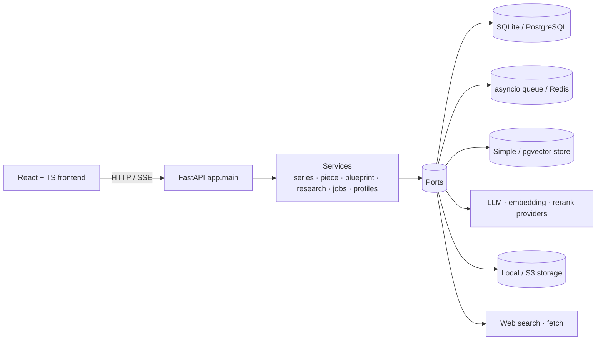

# OpenCGP

**Open Content Generation Platform** · a conversation-driven workspace where generated content stays a living document.

**English** · [简体中文](README.zh-CN.md)

[](LICENSE)
[](backend/requirements.txt)
[](backend/requirements.txt)
[](frontend/package.json)
[](frontend/package.json)
[](frontend/package.json)
[](backend/app/adapters/database)
[](deploy/helm/opencgp)
[](https://github.com/xiaoli-white/opencgp/commits/main)
[](https://github.com/xiaoli-white/opencgp/stargazers)

---

## What is it

OpenCGP is a self-hosted AI writing workspace. You bring a topic; the platform grounds it in your own knowledge base, generates content unit by unit with citations, and then keeps working with you — every follow-up, revision and rollback becomes a comparable version instead of a dead export.

It ships two content shapes on one engine:

- **Series** — multi-unit works (lectures, chapters, scenes) with an outline, per-unit generation, review and version diffs.
- **Standalone piece** — one continuous long-form draft, generated section by section and polished in a single pass.

Both are driven by **creation profiles**: reusable contracts describing what a unit is called, how many, how long, what voice to use, whether citations are required, and which validators must pass.

## Highlights

| Area | What you get |
|---|---|
| **Generation** | Outline → per-unit body → follow-up rewrite; streaming, cancellable, versioned with diff and rollback |
| **Grounding** | Knowledge base with chunking, BM25 + vector hybrid retrieval, **RRF rank fusion**, per-source quota, LSH-bucketed vector index |
| **Retrieval providers** | Embedding and rerank providers registered per user / per tenant / globally, with strict model matching and admin-controlled defaults |
| **Research** | Topic → evidence chain → sub-questions, key findings, contradictions; stage-by-stage progress over SSE |
| **Creation profiles** | Built-in presets plus user-defined specs; scoped to user / tenant / global; import, export, sample draft |
| **Collaboration** | Multi-tenant RBAC (owner / admin / editor / viewer), per-series and per-piece grants, unit-level edit locks |
| **Publishing** | Public read-only share links with token, expiry, revocation and rate limiting; distraction-free reader mode |
| **Export** | Markdown, HTML, EPUB, PDF |
| **Operations** | Background job queue (in-process or Redis) with SSE progress, quotas and usage events, Grafana dashboard, Helm chart with `single` and `ha` topologies |
| **Interface** | React + TypeScript, Chinese and English, dark mode, responsive down to mobile |

## Architecture

Ports & Adapters: every infrastructure dependency sits behind a port, so SQLite ↔ PostgreSQL, in-process queue ↔ Redis, local storage ↔ S3, and hash ↔ real embeddings are all switchable by configuration.



Core runtime properties: 175 HTTP endpoints, 31 tables, single backend process serves API and worker; in `ha` mode the API replicas run with `JOB_CONCURRENCY=0` and dedicated workers drain the queue.

## Quick start

**Requirements** — Python 3.11+, Node 20+, one LLM API key (any OpenAI-compatible endpoint).

```bash
# 1. backend
cd backend
python -m venv .venv && . .venv/bin/activate
pip install -r requirements.txt
cp .env.example .env        # then set OPENCGP_LLM_BASE_URL / _MODEL / _API_KEY
uvicorn app.main:app --reload --port 8000

# 2. frontend (second terminal)
cd frontend
npm ci
npm run dev -- --port 3001  # proxies /api to 127.0.0.1:8000
```

Open <http://127.0.0.1:3001>. `AUTH_MODE=disabled` runs as a local owner account — good for a single-user box; switch to `required` for multi-tenant use.

Everything optional is off by default: without embedding/rerank providers the platform uses keyword + hash embeddings, without Redis it uses the in-process queue, without S3 it writes to `backend/data/storage`.

## Deployment

### Docker Compose

Two images, one compose file. The backend runs uvicorn as a non-root user with a `/health` probe; the frontend is a static nginx build that also reverse proxies `/api` to the backend, so the browser only ever talks to one origin.

```bash
cp .env.example .env                     # ports + VITE_API_BASE for the bundle
cp backend/.env.example backend/.env     # backend settings; set OPENCGP_LLM_* at least
mkdir -p backend/data && sudo chown -R 10001:10001 backend/data
docker compose up -d --build
docker compose ps
curl -s http://127.0.0.1:8000/health     # {"status":"ok", ...}
```

Then open <http://127.0.0.1:3001> (or whatever `FRONTEND_PORT` says).

| What | Where |
|---|---|
| API | `http://127.0.0.1:${BACKEND_PORT:-8000}` |
| UI | `http://127.0.0.1:${FRONTEND_PORT:-3001}` |
| Data volume | `./backend/data` → `/app/data` (SQLite database, uploads, vector store) |
| Health | `docker inspect --format '{{.State.Health.Status}}' opencgp-backend` |

Things worth knowing:

- Compose brings up **one backend container on SQLite with the in-process queue**. Redis, PostgreSQL and S3 are optional — point `OPENCGP_QUEUE_BACKEND`, `OPENCGP_DATABASE_BACKEND` and `OPENCGP_STORAGE_BACKEND` at external services in `backend/.env` when you need them.
- `VITE_API_BASE` is baked in at build time. Leave it empty to call the same origin through nginx; set it only when the UI and the API live on different hosts. Rebuild after changing it: `docker compose build --no-cache frontend`.
- The backend runs as uid `10001`. Make sure the data directory is writable by that user: `sudo chown -R 10001:10001 backend/data`.
- The image already contains a CJK font and WeasyPrint's native dependencies, so Chinese PDF/EPUB export works without extra packages.
- Logs: `docker compose logs -f backend`. Stop and remove: `docker compose down` (add `-v` only if you really want to drop the mounted data).

### Kubernetes (Helm)

```bash
helm lint deploy/helm/opencgp
helm template opencgp deploy/helm/opencgp --set mode=ha --set database.dsn=postgresql://...
```

`mode=single` runs one deployment; `mode=ha` splits API (2 replicas, `JOB_CONCURRENCY=0`) and worker (2 replicas) and refuses to render without a database DSN. A Grafana dashboard is provided in `deploy/grafana/`.

## Configuration

All settings use the `OPENCGP_` prefix (the legacy `COURSE_STUDIO_` prefix is still honoured as a fallback). The relevant groups:

| Group | Keys |
|---|---|
| App | `APP_NAME` `ENV` `LOG_LEVEL` `AUTH_MODE` `AUTH_SECRET` `REQUIRE_APPROVAL` |
| Database | `DATABASE_BACKEND` (`sqlite` \| `postgres`) `DATABASE_DSN` `DATABASE_POOL_SIZE` |
| Retrieval | `VECTORSTORE_BACKEND` `HYBRID_VECTOR_WEIGHT` `HYBRID_LSH_BITS` `HYBRID_MAX_VECTOR_ROWS` |
| Queue | `QUEUE_BACKEND` (`memory` \| `redis`) `REDIS_URL` `JOB_CONCURRENCY` `JOB_MAX_ATTEMPTS` `JOB_SSE_MAX_SECONDS` |
| Storage | `STORAGE_BACKEND` (`local` \| `s3`) |
| LLM | `LLM_BACKEND` `LLM_BASE_URL` `LLM_MODEL` `LLM_API_KEY` |
| Search | `WEBSEARCH_BACKEND` `WEBSEARCH_URL` `WEBSEARCH_API_KEY` `WEBSEARCH_FETCH_ENABLED` `WEBSEARCH_FETCH_TOP` `WEBSEARCH_FETCH_CHARS` |
| Embedding | `EMBEDDING_BACKEND` `EMBEDDING_BASE_URL` `EMBEDDING_MODEL` `EMBEDDING_API_KEY` `EMBEDDING_DIM` `EMBEDDING_BATCH` |
| Rerank | `RERANK_BACKEND` `RERANK_API_KEY` `RERANK_WEIGHT` |

The full, always-current list lives in [`backend/.env.example`](backend/.env.example).

Every key is documented with its default and accepted values in [`docs/configuration.md`](docs/configuration.md).

## Project layout

```
backend/
  app/main.py                 # all HTTP endpoints
  app/config.py               # env loading, OPENCGP_ prefix
  app/container.py            # port → adapter wiring
  app/models/                 # domain models
  app/ports/                  # interfaces (repository, queue, storage, embedding, ranker…)
  app/services/               # series, piece, blueprint, research, jobs, profiles, ingest…
  app/adapters/               # sqlite/postgres, redis queue, simple/pg vector store, providers
  migrations/                 # SQL migration for existing databases
frontend/
  src/pages/                  # workspace, series, pieces, kb, research, jobs, media, settings
  components/                 # shell, series workspace, reader, blueprint, chat, settings
  lib/api.ts                  # typed API client
  src/i18n/dict.ts            # zh + en dictionary
deploy/
  helm/opencgp/               # single / ha topology
  grafana/                    # dashboard
docs/                         # design docs
```

## API

175 endpoints under `/api/v1`, grouped by area:

| Group | Examples |
|---|---|
| Auth & tenant | `POST /auth/login`, `GET /me`, `GET/POST /tenants`, `GET /roles` |
| Series | `GET/POST /series`, `GET /series/{id}`, `POST /series/{id}/units`, `POST /units/{id}/generate` |
| Pieces | `GET/POST /pieces`, `GET /pieces/{id}`, `POST /pieces/{id}/generate` |
| Knowledge base | `POST /kb/sources`, `GET /kb/search`, `POST /kb/embeddings/backfill` |
| Research | `POST /research`, `GET /research/{id}`, `GET /research/{id}/events` |
| Jobs | `GET /jobs`, `GET /jobs/{id}/events` (SSE), `POST /jobs/{id}/cancel` |
| Profiles | `GET/POST /profiles`, `POST /profiles/{id}/sample`, `GET /profiles/{id}/export` |
| Sharing | `POST /share`, `GET /s/{token}` |

Interactive schema: run the backend and open `/docs`.

## Verification

- Retrieval quality: RRF fusion with per-source quota lifted top-1 accuracy from 3/5 to 5/5 on the reference query set
- Vector search: LSH bucketing returns the same neighbours in ~65 ms where a full scan takes ~43 s at 50k vectors
- Concurrency: 40 parallel series creations and 30 parallel job submissions, all accepted, no 5xx
- Failure modes: PostgreSQL or Redis outage degrades to `503` with a clear message and self-heals on recovery
- Interface: every page checked at 1440 and 390 widths — no horizontal overflow, no console errors

## Contributing

Issues and pull requests are welcome. For larger changes, please open an issue first so the design can be discussed. Code is formatted with `ruff`-compatible style on the backend and `tsc --noEmit` clean on the frontend.

## License

[MIT](LICENSE) © 2026 xiaoli-white
