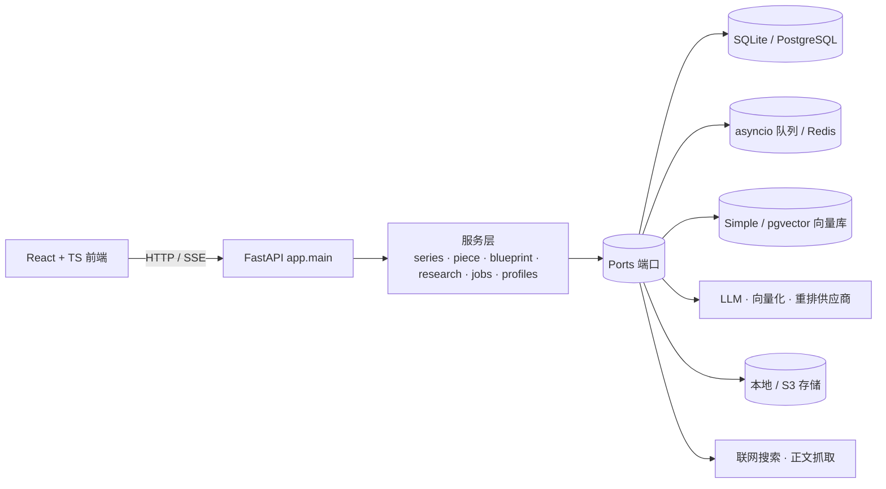

# OpenCGP

**开放内容生成平台** · 以对话为中心，让生成的内容始终是一份"活文档"。

[English](README.md) · **简体中文**

[](LICENSE)
[](backend/requirements.txt)
[](backend/requirements.txt)
[](frontend/package.json)
[](frontend/package.json)
[](frontend/package.json)
[](backend/app/adapters/database)
[](deploy/helm/opencgp)
[](https://github.com/xiaoli-white/opencgp/commits/main)
[](https://github.com/xiaoli-white/opencgp/stargazers)

---

## 它是什么

OpenCGP 是一个可自托管的 AI 创作工作台。你给一个主题，它先在**你自己的知识库里找证据**，再逐个单元带引用地写出来；之后继续陪你追问、局部改写、回滚——每一次改动都沉淀成可对比的版本，而不是一次性的导出文件。

同一套引擎支持两种作品形态：

- **系列** —— 多单元作品（讲 / 章 / 幕），先出大纲，再逐单元生成、审核、版本 diff
- **单篇** —— 一篇连续长文，先出大纲，再逐节生成、最后统一润色

两者都由「**创作配置（Profile）**」驱动：一份可复用的"创作契约"，规定单元叫什么、要几个、每个多长、什么语气、要不要引用、必须过哪些校验。

## 能力一览

| 方向 | 具体能力 |
|---|---|
| **生成** | 大纲 → 逐单元正文 → 追问改写；流式输出、可取消、版本 diff 与回滚 |
| **证据驱动** | 知识库解析/分块，BM25 + 向量混合检索，**RRF 秩融合**，单源配额，LSH 分桶向量索引 |
| **检索供应商** | 向量化与重排供应商按「个人 / 空间 / 全局」三级注册，严格模型一致性校验，管理员控默认 |
| **深度研究** | 主题 → 证据链 → 子问题、关键发现、矛盾点；阶段进度走 SSE |
| **创作配置** | 5 个内置预设 + 自定义；支持作用域、导入导出、试写一段 |
| **协作** | 多租户 RBAC（所有者/管理员/编辑/只读）、系列与单篇级授权、单元级编辑锁 |
| **发布** | 公开只读分享链接（令牌/过期/撤销/限流）、沉浸式阅读模式 |
| **导出** | Markdown / HTML / EPUB / PDF |
| **运维** | 后台任务队列（进程内或 Redis）+ SSE 进度、配额与用量事件、Grafana 看板、Helm `single` / `ha` 两种拓扑 |
| **界面** | React + TypeScript，中英双语，暗色模式，移动端可用 |

## 架构

Ports & Adapters：所有基础设施依赖都在端口之后，所以 SQLite ↔ PostgreSQL、进程内队列 ↔ Redis、本地存储 ↔ S3、hash ↔ 真实向量，全部由配置切换。



运行特征：175 个 HTTP 端点、31 张表；单进程同时承担 API 与 worker；`ha` 模式下 API 副本以 `JOB_CONCURRENCY=0` 运行，由独立 worker 消费队列。

## 快速开始

**环境要求** —— Python 3.11+、Node 20+、一个 LLM API Key（任何 OpenAI 兼容端点）。

```bash
# 1. 后端
cd backend
python -m venv .venv && . .venv/bin/activate
pip install -r requirements.txt
cp .env.example .env        # 填 OPENCGP_LLM_BASE_URL / _MODEL / _API_KEY
uvicorn app.main:app --reload --port 8000

# 2. 前端（另开一个终端）
cd frontend
npm ci
npm run dev -- --port 3001  # 自动把 /api 代理到 127.0.0.1:8000
```

打开 <http://127.0.0.1:3001>。`AUTH_MODE=disabled` 以本地所有者身份运行，适合单机自用；多人协作切到 `required`。

所有可选组件默认关闭：不配向量化/重排供应商时走关键词 + hash 向量；不配 Redis 时用进程内队列；不配 S3 时写 `backend/data/storage`。

## 配置

所有配置项统一 `OPENCGP_` 前缀（历史前缀 `COURSE_STUDIO_` 仍可回退）。主要分组：

| 分组 | 变量 |
|---|---|
| 应用 | `APP_NAME` `ENV` `LOG_LEVEL` `AUTH_MODE` `AUTH_SECRET` `REQUIRE_APPROVAL` |
| 数据库 | `DATABASE_BACKEND`（`sqlite` \| `postgres`）`DATABASE_DSN` `DATABASE_POOL_SIZE` |
| 检索 | `VECTORSTORE_BACKEND` `HYBRID_VECTOR_WEIGHT` `HYBRID_LSH_BITS` `HYBRID_MAX_VECTOR_ROWS` |
| 队列 | `QUEUE_BACKEND`（`memory` \| `redis`）`REDIS_URL` `JOB_CONCURRENCY` `JOB_MAX_ATTEMPTS` `JOB_SSE_MAX_SECONDS` |
| 存储 | `STORAGE_BACKEND`（`local` \| `s3`） |
| LLM | `LLM_BACKEND` `LLM_BASE_URL` `LLM_MODEL` `LLM_API_KEY` |
| 搜索 | `WEBSEARCH_BACKEND` `WEBSEARCH_URL` `WEBSEARCH_API_KEY` `WEBSEARCH_FETCH_ENABLED` `WEBSEARCH_FETCH_TOP` `WEBSEARCH_FETCH_CHARS` |
| 向量化 | `EMBEDDING_BACKEND` `EMBEDDING_BASE_URL` `EMBEDDING_MODEL` `EMBEDDING_API_KEY` `EMBEDDING_DIM` `EMBEDDING_BATCH` |
| 重排 | `RERANK_BACKEND` `RERANK_API_KEY` `RERANK_WEIGHT` |

完整且持续更新的清单见 [`backend/.env.example`](backend/.env.example)。

## 目录结构

```
backend/
  app/main.py                 # 全部 HTTP 端点
  app/config.py               # 环境变量加载（OPENCGP_ 前缀）
  app/container.py            # 端口 → 适配器装配
  app/models/                 # 领域模型
  app/ports/                  # 接口（仓储、队列、存储、向量化、重排…）
  app/services/               # 系列、单篇、蓝图、研究、任务、创作配置、入库…
  app/adapters/               # sqlite/postgres、Redis 队列、simple/pg 向量库、供应商
  migrations/                 # 既有库的 SQL 迁移
frontend/
  src/pages/                  # 工作台、系列、单篇、知识库、研究、任务、图片库、设置
  components/                 # 外壳、系列工作区、阅读器、蓝图、对话、设置
  lib/api.ts                  # 类型化 API 客户端
  src/i18n/dict.ts            # 中英词典
deploy/
  helm/opencgp/               # single / ha 拓扑
  grafana/                    # 看板
docs/                         # 设计文档
```

## API

`/api/v1` 下共 175 个端点，按域分组：

| 分组 | 示例 |
|---|---|
| 鉴权与空间 | `POST /auth/login`、`GET /me`、`GET/POST /tenants`、`GET /roles` |
| 系列 | `GET/POST /series`、`GET /series/{id}`、`POST /series/{id}/units`、`POST /units/{id}/generate` |
| 单篇 | `GET/POST /pieces`、`GET /pieces/{id}`、`POST /pieces/{id}/generate` |
| 知识库 | `POST /kb/sources`、`GET /kb/search`、`POST /kb/embeddings/backfill` |
| 研究 | `POST /research`、`GET /research/{id}`、`GET /research/{id}/events` |
| 任务 | `GET /jobs`、`GET /jobs/{id}/events`（SSE）、`POST /jobs/{id}/cancel` |
| 创作配置 | `GET/POST /profiles`、`POST /profiles/{id}/sample`、`GET /profiles/{id}/export` |
| 分享 | `POST /share`、`GET /s/{token}` |

启动后端后访问 `/docs` 可交互调试。

## 部署

```bash
helm lint deploy/helm/opencgp
helm template opencgp deploy/helm/opencgp --set mode=ha --set database.dsn=postgresql://...
```

`mode=single` 单副本；`mode=ha` 拆成 API（2 副本，`JOB_CONCURRENCY=0`）+ Worker（2 副本），缺数据库 DSN 会直接渲染失败。Grafana 看板在 `deploy/grafana/`。

## 验证情况

- 检索质量：RRF 秩融合 + 单源配额，让参考查询集的 top-1 命中从 3/5 提升到 5/5
- 向量检索：5 万向量下 LSH 分桶约 65 ms，全量扫描约 43 s
- 并发：40 并发建系列、30 并发提交任务全部受理，无 5xx
- 故障：PostgreSQL 或 Redis 断开时降级为 `503` 并给出明确提示，恢复后连接池自愈
- 界面：所有页面在 1440 与 390 宽度下检查，无横向溢出、无控制台报错

## 参与贡献

欢迎提 Issue 和 PR。较大的改动建议先开 Issue 讨论设计。后端保持 ruff 风格，前端保持 `tsc --noEmit` 通过。

## 许可

[MIT](LICENSE) © 2026 xiaoli-white
